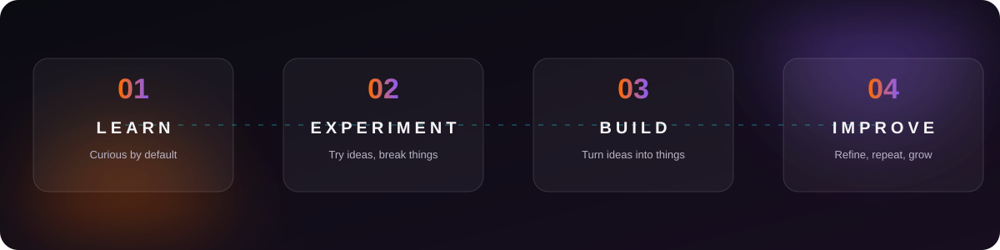

 

  

## ◆ ABOUT

Hi, I'm **Nahidul Islam** — **NAHU** to friends. An independent builder from Bangladesh who loves turning ideas into digital things.

I explore modern tools, learn by building, and share the journey here. Curious first. Purposeful always.

## ◆ CREATIVE TOOLKIT

## ◆ PERSONAL JOURNEY

## ◆ GITHUB ACTIVITY

## ◆ CONNECT

 

